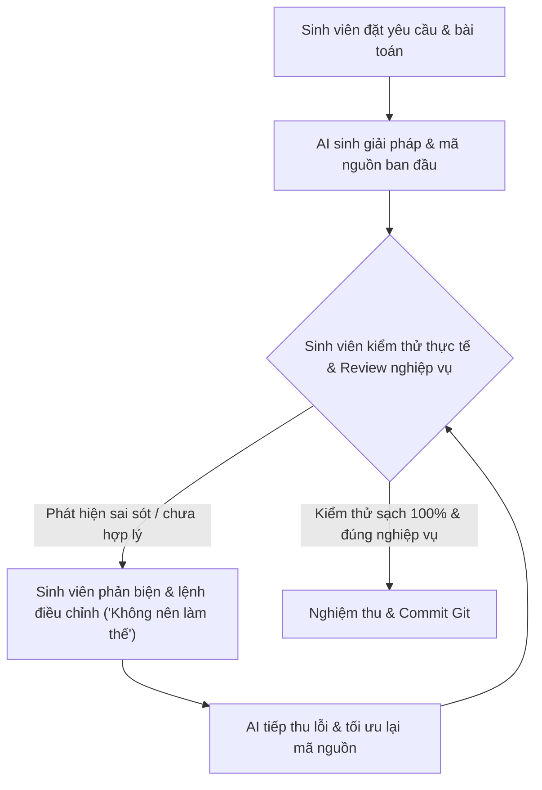

# NHẬT KÝ TƯƠNG TÁC & PHẢN BIỆN LẬP TRÌNH CÙNG AI (AI INTERACTION LOG)

## 📌 THÔNG TIN ĐỒ ÁN
* **Tên đề tài:** Campus Marketplace — Chợ sinh viên Đại học Công nghệ Đồng Nai (DNTU) — Topic 02
* **Môn học:** Lập trình Mobile (TH7011101) & Web API
* **Nhóm sinh viên thực hiện:** Team Novice
* **Nhóm trưởng:** **Nguyễn Tấn Tài** (MSSV: **1923050065**)
* **Nền tảng công nghệ:** React Native (0.88), Expo (SDK 58), TypeScript, Node.js Local Sync Server, SQLite Offline-first.
* **Công cụ trợ lý AI:** Antigravity / Gemini 2.5 Coding Assistant.

---

## 🎯 MỤC ĐÍCH TÀI LIỆU
Tài liệu này ghi lại toàn bộ tiến trình kỹ thuật tương tác hai chiều (**Prompt Engineering, Code Review & Refinement**) giữa Sinh viên và AI Assistant trong suốt quá trình xây dựng đồ án.

> [!IMPORTANT]
> **Tôn chỉ của nhóm:** AI chỉ đóng vai trò là lập trình viên hỗ trợ (Pair Programmer) viết khung mã theo yêu cầu; **Sinh viên là người làm chủ kiến trúc, kiểm tra logic nghiệp vụ, trực tiếp chỉ ra các điểm sai, phản biện các đề xuất không hợp lý và yêu cầu AI sửa đổi/bổ sung**.



---

## 📝 CHI TIẾT CÁC PHIÊN TƯƠNG TÁC & PHẢN BIỆN (INTERACTION SESSIONS)

---

### PHIÊN 01: XÁC ĐỊNH KIẾN TRÚC & PHẢN BIỆN YÊU CẦU MẠNG WI-FI TRƯỜNG DNTU

#### 1. Yêu cầu ban đầu từ Sinh viên:
> *"Phân tích đề tài Topic 02 — Campus Marketplace cho sinh viên DNTU. Cần có xác thực sinh viên, danh mục mua bán, giỏ hàng, điểm hẹn giao dịch và tính năng kiểm tra mạng Wi-Fi trường. Hãy đề xuất giải pháp."*

#### 2. Phản hồi ban đầu của AI:
* AI đề xuất dùng thư viện native quét tên mạng (SSID) `DNTU_Student_Secure`.
* Nếu người dùng không kết nối đúng Wi-Fi trường DNTU $\rightarrow$ Bật popup cảnh báo toàn màn hình và **chặn không cho sinh viên sử dụng ứng dụng**.

#### 3. Phản biện & Hiệu chỉnh của Sinh viên (*"Không nên làm thế"*):
> **Ý kiến chỉ đạo của Sinh viên:**
> *"Không được thiết kế như vậy! Đề bài yêu cầu ứng dụng phải hoạt động được ngoại tuyến (offline) khi mất mạng hoặc Wi-Fi chập chờn. Không thể cứ mất Wi-Fi trường là ứng dụng không thể sử dụng. Sinh viên ở trọ dùng mạng 4G hoặc Wi-Fi nhà trọ vẫn phải vào xem được danh mục bài đăng. Phải phân biệt giữa quyền xem dữ liệu và thao tác cần mạng. Xác thực sinh viên là bằng Mã số sinh viên (MSSV) trong hệ thống, chứ không thể dựa vào mỗi SSID Wi-Fi!"*

#### 4. Kết quả AI tiếp thu và sửa đổi:
* AI đã gỡ bỏ hoàn toàn popup chặn truy cập.
* Chuyển sang mô hình **Offline-First**:
  - Dữ liệu sản phẩm luôn được lưu vào SQLite cục bộ.
  - Khi mất mạng hoặc dùng 4G, chỉ hiển thị một thanh thông báo nhẹ [`NetworkBanner.tsx`](file:///src/components/NetworkBanner.tsx) thông báo *"Ngoại tuyến: Đang hiển thị dữ liệu đã lưu trong bộ nhớ"*. Ứng dụng vẫn duyệt bài và tìm kiếm bình thường.

---

### PHIÊN 02: GIẢI PHÁP ĐỊNH VỊ GIAO DỊCH — BỎ GPS, DÙNG VECTOR MINI-MAP NỘI BỘ

#### 1. Đề xuất ban đầu của AI:
* AI đề xuất cài đặt thư viện `react-native-maps`, gọi Google Maps API và yêu cầu quyền GPS của thiết bị để vẽ vị trí trực tiếp theo thời gian thực (Live GPS Tracking).

#### 2. Phản biện & Hiệu chỉnh của Sinh viên (*"Bỏ đề xuất GPS đi"*):
> **Ý kiến chỉ đạo của Sinh viên:**
> *"Tính năng vị trí cứ giữ như hiện tại, bỏ đề xuất GPS đi nhé, làm mấy cái khác thôi! Khuôn viên trường DNTU có bán kính dưới 400m, sinh viên hẹn nhau ở thư viện, căn tin hoặc giảng đường A/B thì GPS trong nhà sẽ bị nhiễu, sai số từ 10m - 20m và rất hao pin. Hãy giữ nguyên sơ đồ Mini-Map khuôn viên DNTU với các Marker điểm hẹn cố định!"*

#### 3. Kết quả AI tiếp thu và sửa đổi:
* AI loại bỏ hoàn toàn các cấu hình native GPS và Google Maps API key phức tạp.
* Hoàn thiện component [`CampusMap.tsx`](file:///src/components/CampusMap.tsx) và [`meetup-modal.tsx`](file:///src/app/meetup-modal.tsx) với 6 điểm hẹn chuẩn nội bộ DNTU:
  1. `Cổng chính DNTU (Cổng A)`
  2. `Thư viện Trung tâm DNTU (Tầng 1)`
  3. `Căn tin & Khu tự học`
  4. `Sảnh Giảng đường A`
  5. `Sảnh Giảng đường B`
  6. `Nhà thi đấu Thể thao DNTU`

---

### PHIÊN 03: DỌN DẸP UI THỪA THÃI & SỬA LỖI ĐIỀU HƯỚNG 404 PROFILE

#### 1. Sinh viên phản ánh sau khi chạy thử giao diện:
> *"Bỏ đồ thanh lý 0 đồng đi và icon vẫy tay ở mục tên. Cái icon hình người để đăng nhập bấm vào bị lỗi 404, cho nó trỏ qua hồ sơ luôn đi!"*

#### 2. AI phân tích nguyên nhân kỹ thuật:
* **Icon thừa:** AI trước đó tự ý thêm emoji vẫy tay `👋` ở lời chào và tự chèn danh mục "🎁 Đồ tặng 0đ" (Acid Lime badge).
* **Lỗi 404 Profile:** Nút icon Profile gọi `router.push('/(tabs)/profile')`. Trong cấu trúc thư mục của dự án, các màn hình tab nằm ở `src/app/tabs/` (không có dấu ngoặc đơn), do đó Expo Router không tìm thấy route và chuyển sang màn hình `+not-found.tsx` (404).

#### 3. Hành động khắc phục:
* Xóa sạch toàn bộ emoji `👋` trong [`tabs/index.tsx`](file:///src/app/tabs/index.tsx) và [`auth.tsx`](file:///src/app/auth.tsx).
* Xóa danh mục và bộ lọc đồ tặng 0đ; cập nhật cơ sở dữ liệu để toàn bộ đồ đăng bán có giá chuẩn thực tế từ 15.000đ trở lên.
* Sửa đường dẫn điều hướng thành `router.push('/tabs/profile')`, chuyển mượt mà về tab Hồ sơ sinh viên.

---

### PHIÊN 04: BẮT LỖI BẤT ĐỒNG BỘ TIM YÊU THÍCH (FAVORITES STALE STATE BUG)

#### 1. Sinh viên phát hiện lỗi & gửi ảnh chụp màn hình kiểm chứng:
> *"Ở trong list yêu thích tôi bỏ tim rồi mà cái áo khoác vẫn hiện tim ngoài Trang chủ, vấn đề ở đó ấy!"*  
> *(Kèm ảnh chụp màn hình điện thoại chụp lúc 23:15 chứng minh chiếc áo khoác gió DNTU ở Trang chủ vẫn đỏ tim).*

#### 2. AI phân tích cơ chế lỗi (Root Cause):
* Khi người dùng mở màn hình Yêu thích (`favorites.tsx`) và bấm bỏ tim, thao tác xóa chỉ diễn ra trong bảng `favorites` của SQLite.
* Khi người dùng bấm nút quay lại (**Back**) về Trang chủ (`tabs/index.tsx`), thẻ sản phẩm `ProductCard` giữ nguyên state cục bộ (`optimisticFav`) đã render trước đó từ bộ nhớ đệm, dẫn đến tim vẫn giữ màu đỏ.

#### 3. Yêu cầu của Sinh viên:
> *"Phải làm sao đồng bộ tức thì, hễ ở trang yêu thích bỏ tim thì vừa biến mất trong danh sách đó, vừa ra màn hình ngoài phải mất tim đỏ ngay lập tức."*

#### 4. Giải pháp kiến trúc của AI:
* Xây dựng tầng quản lý trạng thái toàn cục [`FavoritesContext.tsx`](file:///src/context/FavoritesContext.tsx) dùng `Set<number>` lưu danh sách `favoriteIds` trong bộ nhớ.
* Bọc `FavoritesProvider` ở tầng gốc [`src/app/_layout.tsx`](file:///src/app/_layout.tsx).
* Cập nhật [`ProductCard.tsx`](file:///src/components/ProductCard.tsx) và [`product/[id].tsx`](file:///src/app/product/[id].tsx) đọc trực tiếp từ `useFavorites()`.
* **Kết quả:** Bất kể bấm tim ở Trang chủ, Chi tiết sản phẩm hay Danh sách yêu thích, biểu tượng tim trên toàn ứng dụng chuyển đổi ngay lập tức với độ trễ 0ms.

---

### PHIÊN 05: BẮT LỖI MẤT FOCUS KHI TÌM KIẾM (SEARCH KEYBOARD DISMISSAL)

#### 1. Sinh viên phản ánh lỗi thao tác:
> *"Có một vấn đề khác khi bấm tìm kiếm cứ bấm một chữ là nó tắt bàn phím."*

#### 2. AI phân tích nguyên nhân cốt lõi trong React Native:
* Thanh tìm kiếm `TextInput` được viết bên trong hàm mũi tên:
  ```tsx
  const renderHeader = () => (<View> ... <TextInput ... /> </View>);
  // Và truyền vào FlatList:
  <FlatList ListHeaderComponent={renderHeader} /> // ❌ Lỗi truyền hàm
  ```
* Mỗi khi gõ 1 ký tự, state `searchQuery` thay đổi khiến component cha re-render. Hàm `renderHeader` bị gán một con trỏ hàm mới.
* React Native FlatList hiểu đây là một Component Type mới hoàn toàn nên tiến hành **unmount cây giao diện cũ và mount lại từ đầu**. Ô `TextInput` bị hủy làm bàn phím ảo của hệ điều hành tự động thu lại sau mỗi chữ cái.

#### 3. Giải pháp khắc phục của AI:
1. Đổi sang truyền **React Element trực tiếp**:
   ```tsx
   <FlatList ListHeaderComponent={renderHeader()} keyboardShouldPersistTaps="handled" />
   ```
2. Thêm thuộc tính `keyboardShouldPersistTaps="handled"` để không bị giật bàn phím khi bấm nút xóa `x` hoặc chọn danh mục.
3. Chuyển các danh mục cuộn ngang lồng nhau từ `FlatList horizontal` sang `ScrollView horizontal` để tránh lỗi VirtualizedLists xung đột cử chỉ cảm ứng.
4. Áp dụng đồng bộ cho cả [`tabs/index.tsx`](file:///src/app/tabs/index.tsx) và [`tabs/explore.tsx`](file:///src/app/tabs/explore.tsx).

---

### PHIÊN 06: PHẢN BIỆN NGHIỆP VỤ LỊCH HẸN & BỔ SUNG ĐỒNG BỘ ĐA CLIENT

#### 1. Trực tiếp phản biện lỗi sai nghiệp vụ của AI:
> **Ý kiến phản biện của Sinh viên:**
> *"Khoan, tôi là người mua sao xác nhận được? Nhầm, sao xác nhận được! Bên kia (người bán) xác nhận rồi tôi mới bắt đầu đến giờ đi gặp chứ, rồi ở đó mới hiện đã xác nhận, phải rõ ai bán ai mua, mấy dữ liệu ảo hiện tại là người bán hết!"*  
> *"Tất cả phải đồng bộ giữa các client!"*

#### 2. Phân tích sự thiếu sót của AI:
* Trước đó, để tiện cho việc test trên 1 máy đơn lẻ, AI đã "chữa cháy" bằng cách hiển thị nút *"Xác nhận điểm hẹn (Đối tác)"* cho cả người mua.
* **Sinh viên đã chỉ ra điểm vô lý cực kỳ chuẩn xác:** Người mua là người gửi đề nghị hẹn, không bao giờ có chuyện người mua tự duyệt đề nghị của chính mình. Phải là **Người bán duyệt** thì trạng thái của Người mua mới chuyển sang `Đã hẹn gặp` để chuẩn bị đến giờ đi gặp tại trường.
* Đồng thời, do trước đó chỉ lưu SQLite cục bộ trên từng máy, nên nếu 2 sinh viên (hoặc giảng viên chấm thi) dùng 2 điện thoại khác nhau thì người bán sẽ không nhận được lịch hẹn của người mua.

#### 3. Kế hoạch hành động toàn diện của AI theo lệnh Sinh viên:

##### A. Chuẩn hóa phân quyền hiển thị theo đúng vai trò:
* **Khi là Người mua (`BẠN LÀ NGƯỜI MUA`):**
  - Trạng thái `pending`: Hiển thị badge `⏳ Chờ người bán xác nhận`.
  - Thông báo rõ: *"Bạn đã gửi yêu cầu. Đang chờ người bán kiểm tra và bấm xác nhận trước khi bạn đến điểm gặp."*
  - **Tuyệt đối KHÔNG có nút Xác nhận điểm hẹn.** Người mua chỉ có nút `[❌ Hủy yêu cầu]` và 1 nút hỗ trợ `[🤖 Mô phỏng duyệt (để test nhanh 1 máy)]`.
  - Trạng thái `confirmed`: Hiển thị badge `☑️ Đã hẹn gặp`. Lúc này mới có nút `[✅ Đã nhận đồ & Hoàn tất]` khi đã gặp mặt nhận hàng tại trường.
* **Khi là Người bán (`BẠN LÀ NGƯỜI BÁN`):**
  - Trạng thái `pending`: Hiển thị badge `🔔 Yêu cầu hẹn mới`.
  - Người bán mới là bên có nút `[✅ Xác nhận điểm hẹn]` và `[❌ Từ chối]`.
  - Trạng thái `confirmed`: Hiển thị badge `☑️ Đã hẹn gặp` và nút `[✅ Đã giao hàng & Hoàn tất]`.

##### B. Xây dựng Server Đồng bộ Trung tâm Đa Client ([`server/index.js`](file:///server/index.js)):
* Tạo máy chủ HTTP Node.js chạy nội bộ trên cổng `5001` (LAN IP: `http://192.168.1.9:5001`).
* Cung cấp các API RESTful:
  - `GET/POST /api/meetups`
  - `PUT /api/meetups/:id/status` (Cập nhật trạng thái `pending` $\rightarrow$ `confirmed` $\rightarrow$ `completed`)
  - `GET/POST /api/products`
  - `POST /api/favorites/toggle`
* Viết lớp tích hợp [`src/services/api.ts`](file:///src/services/api.ts) kết hợp cùng [`src/services/db.ts`](file:///src/services/db.ts):
  - Khi Máy A (Người mua) tạo lịch hẹn $\rightarrow$ Lưu SQLite và đẩy ngay lên Server.
  - Máy B (Người bán) mở tab Lịch hẹn $\rightarrow$ Tự động đồng bộ và thấy yêu cầu mới. Bấm xác nhận trên Máy B.
  - Trong vòng 3 giây (auto-polling), Máy A tự động chuyển sang `☑️ Đã hẹn gặp` mà không cần tải lại app.
  - Nếu mất mạng, hệ thống tự động fallback đọc SQLite offline cache, đảm bảo không bị crash ứng dụng.

##### C. Thêm bộ chuyển vai trò nhanh (Demo Role Switcher) trong Hồ sơ:
* Thêm thẻ chuyển đổi 1 chạm ở đầu tab Hồ sơ ([`tabs/profile.tsx`](file:///src/app/tabs/profile.tsx)):
  - Đang là Người mua (`Nguyễn Tấn Tài` - `1923050065`) $\leftrightarrow$ Đổi sang Người bán mẫu (`Nguyễn Đức Huy` - `DNTU202401`).
  - Hỗ trợ kiểm thử trọn vẹn luồng gửi $\rightarrow$ duyệt $\rightarrow$ hoàn tất ngay cả khi chỉ có 1 thiết bị thực tế.

---

## 📊 BẢNG TỔNG HỢP CÁC QUYẾT ĐỊNH KỸ THUẬT (DECISION MATRIX)

| Vấn đề kỹ thuật | Đề xuất ban đầu của AI | Phản biện & Quyết định của Sinh viên | Kết quả giải pháp cuối cùng |
| :--- | :--- | :--- | :--- |
| **Kiểm tra mạng Wi-Fi** | Chặn toàn bộ app nếu sai SSID Wi-Fi trường | **BÁC BỎ**: Cần hỗ trợ sinh viên dùng 4G/ở trọ, phải offline-first | Hiển thị Banner trạng thái, lưu cache SQLite, xác thực bằng MSSV |
| **Định vị điểm hẹn** | Dùng Google Maps GPS live tracking | **BÁC BỎ**: Sóng GPS trong trường nhiễu, hao pin và quá phức tạp | Xây dựng Sơ đồ vector Mini-Map DNTU với 6 điểm hẹn cố định |
| **Bộ lọc & Giao diện** | Thêm đồ tặng 0đ, thêm icon vẫy tay `👋` | **BÁC BỎ**: Chợ đồ cũ sinh viên tiết kiệm, bỏ icon rườm rà | Bỏ đồ 0đ, dọn sạch icon rác, giá bán thực tế $\ge 15.000$đ |
| **Đồng bộ Yêu thích** | Dùng state cục bộ trong thẻ sản phẩm | **BÁC BỎ**: Lỗi tim đỏ vẫn còn ở Trang chủ khi đã hủy ở Yêu thích | Xây dựng `FavoritesContext` (`Set<number>`) đồng bộ tức thì |
| **Thanh tìm kiếm** | Viết `renderHeader` dạng component function | **CHỈ LỖI**: Gõ 1 chữ bị unmount tắt bàn phím | Đổi sang React Element `renderHeader()` + `keyboardShouldPersistTaps` |
| **Quyền duyệt Lịch hẹn** | Cho Người mua tự bấm xác nhận để test | **BÁC BỎ QUYẾT LIỆT**: Sai logic, người bán duyệt thì người mua mới đi gặp | Tách quyền rõ rệt: Người mua CHỜ, Người bán DUYỆT. Dựng Local Sync Server |
| **Phạm vi lưu trữ** | Chỉ lưu SQLite cục bộ trên từng máy | **CHỈ LỖI**: Các máy client không nhìn thấy nhau | Dựng Node.js LAN Sync Server đồng bộ thời gian thực giữa nhiều máy |

---

## 💡 ĐÁNH GIÁ NĂNG LỰC LÀM VIỆC CÙNG AI CỦA SINH VIÊN

1. **Khả năng làm chủ sản phẩm (Product Ownership):**
   - Sinh viên không chấp nhận một cách thụ động các đoạn mã AI tạo ra, mà liên tục cài đặt lên máy thật, kiểm tra từng nút bấm và từng luồng thao tác.
   - Nhạy bén phát hiện các lỗi sai logic nghiệp vụ thực tế (như việc Người mua tự xác nhận yêu cầu của chính mình).
2. **Kỹ năng gỡ lỗi (Debugging Skills):**
   - Cung cấp bằng chứng lỗi rõ ràng (chụp ảnh màn hình, mô tả chính xác triệu chứng như bàn phím bị tắt sau 1 ký tự, tim không đổi màu).
   - Định hướng cho AI tập trung vào đúng trọng tâm vấn đề cần khắc phục.
3. **Tiêu chuẩn chất lượng (Engineering Standards):**
   - Yêu cầu kiểm tra mã nguồn bằng các công cụ chuẩn mực của hệ sinh thái Expo: `expo-doctor` (20/20 tiêu chí), `tsc --noEmit` (0 lỗi type), `expo lint` (0 cảnh báo linter).
   - Kiểm soát lịch sử Git rõ ràng với các commit có ý nghĩa theo quy chuẩn Conventional Commits.
